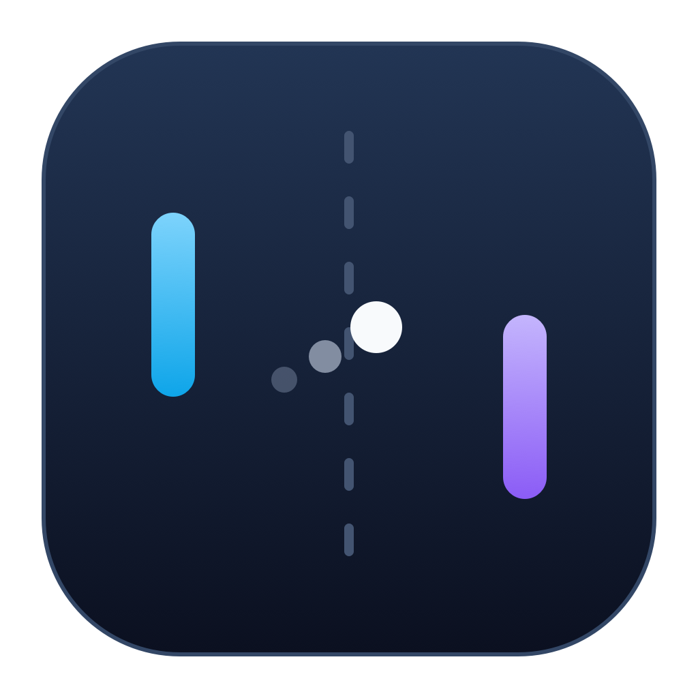

# GPUI Pong



A small local two-player Pong game built with Rust and [GPUI](https://www.gpui.rs/). Includes continuous paddle movement, scoring, angled rebounds, pause/resume, and a standalone macOS app bundle.

## Requirements

- macOS with Metal support. Tested on Apple Silicon; Intel Macs and other platforms have not been tested.
- Current stable Rust and Cargo, installed with [rustup](https://rustup.rs/).
- Apple's Command Line Tools (`xcode-select --install`).

GPUI's `runtime_shaders` feature compiles Metal shaders at startup, so the build does not need the full Xcode Metal compiler. GPUI is pinned to 0.2.2, and `Cargo.lock` is checked in to preserve tested dependency versions.

## Run from source

From the cloned repository:

```sh
cargo run --locked
```

If Homebrew's `rustup` is installed but `cargo` or `rustc` is missing from your PATH, first run:

```sh
export PATH="$(dirname "$(rustup which cargo)"):$PATH"
```

## Controls

| Control | Action |
| --- | --- |
| W / S | Player 1 up / down |
| Up / Down arrows | Player 2 up / down |
| Space | Pause / resume |
| R or Restart game | Reset scores and start again |
| Command-Q | Quit |

Hold movement keys for continuous motion; both players can move at once. Missing the ball awards the other player a point, followed by a short serve delay. The ball speeds up during rallies, and where it hits a paddle determines the rebound angle. There is no score limit.

Switching windows suspends the game and clears held keys. Click the court to restore keyboard focus if needed.

## Build a standalone macOS app

```sh
./scripts/bundle-macos.sh
open "dist/GPUI Pong.app"
```

Double-click the app in Finder or copy it to Applications. It runs without Rust, Cargo, or the project source. The script builds for the host Mac's architecture; the current tested build is Apple Silicon (arm64).

The app is ad-hoc signed for local use. It is not Developer ID signed or notarized. The plain executable is at `target/release/gpui-testing`.

Build products in `target/` and `dist/` are ignored by Git. Distribute packaged apps as GitHub Release attachments rather than adding binaries to the source repository.

## Development

```sh
cargo fmt --all -- --check
cargo test --locked
cargo clippy --locked --all-targets -- -D warnings
```

GitHub Actions runs these checks on macOS for pushes and pull requests.

- `src/main.rs`: window, UI, keyboard input, and animation loop.
- `src/game.rs`: game state and physics, stepped at 120 Hz independently of display refresh rate.
- `assets/`: app icon artwork and the `.icns` used by the bundle.
- `scripts/bundle-macos.sh`: release build, bundle metadata, icon installation, and local signing.
- `scripts/generate-icon.swift`: reproducible icon artwork. To regenerate on macOS:

```sh
mkdir -p target/icon-work
swift scripts/generate-icon.swift target/icon-work
iconutil -c icns target/icon-work/Pong.iconset -o assets/Pong.icns
cp target/icon-work/Pong.png assets/Pong.png
```

GPUI API reference: <https://docs.rs/gpui/0.2.2/gpui/>.

## License

This project's source and original icon artwork are licensed under the [MIT License](LICENSE). Third-party dependencies retain their respective licenses.
